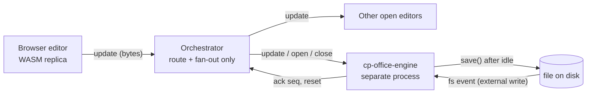

# cp-office-engine: CRDT-only office editing

Status: phase 0 done (2026-10-23, go for all three formats), phase 1 in progress. Supersedes the transport part of `design-office-live-updates.md` (the opaque update log stays, but the engine now lives in the backend).
Scope: `.docx`, `.xlsx`, `.pptx` in the Finder, all three at once.

## Decisions (user, 2026-10-23)

1. Every user edit is a CRDT update, sent as soon as it happens. No whole-file upload from the browser, ever.
2. Ctrl+S only flushes pending updates early. In steady state there is nothing left to flush.
3. An agent may still rewrite the file directly (openpyxl, python-docx, our own tools). The engine sees it through a file watcher, reloads the whole file, and the open editor does a full reload.
4. The orchestrator never blocks: it only routes bytes. Parsing, merging and saving run in a separate process.
5. BetterOffice's Rust engine is imported as-is for now (vendored, pinned, our patches as `.diff`). No rewrite to our standards in this phase.
6. Word, Excel and PowerPoint go through the same path from day one.

## Architecture

- **Browser**: the BetterOffice React editors in collaborative mode (`collaboration.{clientId, initialUpdate, onReplica}`). Local updates go out immediately (one update per transaction, coalesced over ~50 ms at most).
- **Orchestrator**: holds a channel to the engine process and one SSE subscription per open document. It forwards bytes and never decodes them. Every call is O(size of the update) and never waits on the engine.
- **cp-office-engine**: one process, one resident document per open file. It applies updates, writes the file, watches the disk.
- **Disk**: still the source of truth. The engine's memory is a cache of it plus edits not yet written.

## Why a backend engine

Without it, the file on disk can only be produced by a browser (`save()` in WASM), which forces a full upload per save, and nobody materialises edits when the tab is closed. With it, the browser only ever sends deltas, and the engine writes the file.

The native crates expose what we need (checked in `/tmp/betteroffice/crates`):

| Format | Open collaboratively | CRDT | Save |
|---|---|---|---|
| xlsx | `Workbook::open_collaborative(bytes, client_id)` | `encode_state_as_update_v1`, `encode_diff_v1`, `apply_update_v1` | `Workbook::save` |
| pptx | `Presentation::open_collaborative(bytes, client_id)` | same three | `Presentation::save` |
| docx | `docx-edit` (yrs `Doc`, `apply_update_v1`, `apply_update_chunks_v1`) | via `yrs_doc()` | `betteroffice-docx` `Document::save` |

docx has no native path from an edited replica to a file: `betteroffice-docx::Document::save` serialises its own parsed model, and the CRDT → .docx step (`saveYrsDocx`, ~900 lines) exists only in TypeScript. So docx runs in a **Node/Bun sidecar** using `@betteroffice/docx` headless (`createYrsSession`, `openDocx`, `applyUpdate`, `saveYrsDocx`). Porting that step to Rust is out of scope.

### Phase 0 results

| Format | Engine | Result |
|---|---|---|
| xlsx | Rust | WASM accepts the native base; a 58-byte browser update applied natively and saved is in the file. Open: 0.5 s small, 1.9 s Dalia (1.8 MB). |
| pptx | Rust | Same, 502-byte update, apply+save 29 ms, open 11 ms. Only with a WASM built from the **same commit**: npm 0.2.0 rejects the native state (`unsupported deck schema version`). |
| docx | Node | Headless in Node: 1.3 MB file opens in 0.33 s, 737-byte update, `saveYrsDocx` keeps it. |

Native xlsx+pptx binary: 12 MB, cold release build 95 s. Spike code: `/tmp/bo-spike`, `/tmp/bo-p0`.

## Shared base: the browser joins from the engine

CRDT updates only merge between replicas built on the same base. Phase 0 showed that native and WASM build the same base from the same bytes, but the full state is too big to ship on open (Dalia: 40 MB). So the browser opens the **epoch's base bytes** and only fetches what changed since:

1. `GET office/open?path=` → the engine opens the file (or reuses the resident document) and returns `{doc_id, epoch, base_version}`.
2. The editor fetches the base bytes (`GET office/base?doc=&epoch=`) and opens them collaboratively.
3. It sends its state vector; the engine answers `encode_diff_v1(sv)`: only the edits made since the base (usually a few KB).
4. From then on it applies remote updates and sends its own.

The base bytes are the file as it was when the epoch started, kept in memory by the engine. They are **not** the current file on disk: after the engine saves, disk bytes differ, and a replica opened from them would not merge. A new epoch (new base = current disk) starts on an external write or when the document is reopened after release.

`epoch` changes on every full reload (see below). Any update tagged with an old epoch is rejected with 409, and the editor reloads.

This holds only when browser and engine run the same BetterOffice commit (see "Importing the engine"). A test per format guards it in CI.

## Protocol

All routes sit next to the existing `fs/office` ones.

| Route | Who | Orchestrator work | Engine work |
|---|---|---|---|
| `GET office/open?path=` | editor | forward, stream reply | open or reuse, return state |
| `POST office/update?doc=&epoch=` (body = update bytes) | editor, later agent tool | push to the engine queue, fan out to other subscribers, return 202 | apply, mark dirty, ack `seq` |
| `POST office/flush?doc=` (Ctrl+S) | editor | forward | save now, return the file version |
| `GET office/events?doc=` (SSE) | editor | stream | emits `update`, `saved{version}`, `reset{epoch}`, `error` |
| `POST office/close?doc=` | editor (unmount, pagehide beacon) | forward | drop a subscriber |

Orchestrator ↔ engine: a Unix socket with length-prefixed frames (`open`, `update`, `flush`, `close`, `ack`, `saved`, `reset`). The orchestrator keeps a bounded queue per document. If the queue is full or the engine is down, `update` returns 503 and the editor retries. Nothing in the orchestrator waits on an engine reply while holding the backend lock.

## Flows

**User edit**: the replica emits an update → `POST office/update` → the orchestrator fans it out to other tabs and queues it for the engine → the engine applies it and marks the doc dirty → after 2 s idle (and at most every 10 s under constant typing) the engine runs `save()` and writes the file atomically (`cp-office::write`) → emits `saved{version}`. The status bar shows "Saved" on `saved`.

**Ctrl+S**: the editor sends any update still pending, then `office/flush`. The engine saves immediately. Normally there is nothing pending, so this is just a forced write.

**Agent edits the file directly**: the watcher sees a write whose version is not the one the engine just wrote → the engine re-opens the file from disk, bumps `epoch` → `reset{epoch}` → every open editor does a full reload (keeping sheet/slide, scroll and selection where possible). If the engine had unsaved edits at that moment, they are lost; to keep this window small, the engine saves dirty documents within 2 s, and logs the conflict. Writes by the engine itself are recognised by the version it wrote, so they don't trigger a reset.

**Agent edits through CRDT** (later phase, not required now): an agent tool sends an update to `office/update` like a browser. The open editor applies it in place, with no reload.

## Lifecycle: when the engine releases a document

A document stays resident while:
- at least one editor is subscribed, or
- it is dirty (unsaved edits).

It is released when it has no subscriber and is clean, after a 60 s grace period (so a tab reload doesn't re-parse a 2 MB workbook). Also:
- **memory cap**: if the total resident size goes over a budget (e.g. 1.5 GB), the least recently used clean document without subscribers is released first; dirty documents are saved before release;
- **tab closed without `close`**: SSE disconnect counts as unsubscribe;
- **file deleted or renamed**: the document is saved nowhere, subscribers get `error{gone}`, and it is released;
- **watcher**: one watch per resident document (not the whole realm), removed on release.

## Failure handling

- **Engine crash**: the supervisor restarts it. Resident state is lost; unsaved edits since the last save are lost (≤ 2–10 s). Every editor gets `reset` on reconnect and reloads from disk. To avoid even that loss, the engine can append received updates to `~/.context-pilot/sync/office/<doc>.log` before applying, and replay it on restart (phase 3).
- **Slow engine** (big recalculation, 3 s for the Dalia databook): only its own queue grows. The orchestrator keeps answering; editors keep working locally, since edits are already applied in the browser.
- **Update rejected** (corrupt, wrong epoch): 409 → the editor reloads.

## Importing the engine

- `vendor/betteroffice/` in the workspace: the upstream crates at a pinned commit, plus our `.diff` patches (the six existing xlsx patches move here too, so the WASM and native builds share them).
- New crate `crates/cp-office-engine` (our code, our lints): process main loop, socket protocol, document registry, watcher, save scheduler. Depends on the vendored crates by path. Hosts xlsx and pptx natively.
- docx sidecar: a small Node/Bun script (`cp-office-engine/docx-sidecar/`) running `@betteroffice/docx` from the same commit. The Rust engine spawns and supervises it, and forwards docx frames to it over stdin/stdout; the orchestrator only ever talks to the Rust engine.
- **One pinned commit for everything**: the native crates, the docx sidecar package and all three browser editors are built from the same vendored tree. xlsx already ships that way (`web/vendor/betteroffice/*.tgz`); pptx and docx move off npm to the same scheme.
- The vendored crates are excluded from our lint, structure and hash-chain checks (listed as a third-party tree). Our checks apply to `cp-office-engine` only.
- Same commit builds the WASM for the web editors, so browser and engine never drift.
- Size (measured): 12 MB binary, 95 s cold release build for xlsx+pptx.

## Phases

0. **Spike**: done, go for all three (results above).
1. **Engine + routes, three formats**:
   1. Vendor the pinned BetterOffice tree; build pptx and docx browser packages from it (off npm).
   2. `cp-office-engine` process (xlsx + pptx native) + docx sidecar.
   3. Orchestrator routes and fan-out.
   4. Editors: join via base bytes + diff, delta-only sending, Ctrl+S = flush, `reset` → reload.
   5. Idle save, watcher + reset. Remove the whole-file upload path.
2. **Reload that keeps the view**: sheet/slide, scroll, selection restored after `reset`.
3. **Durability**: update journal replayed after an engine crash; memory cap with LRU release.
4. **Agent CRDT tool** (optional): an agent edit applied in place without reload.

Deploy needs an orchestrator restart (drops every agent), so it waits for the user's OK.

## Open questions

- Several realms/agents opening the same file: one resident document keyed by absolute path, shared by all.
- Should the engine run one process per format or one for all three? Start with one.
