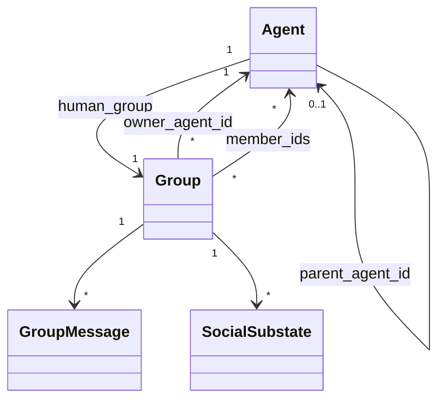

# Orchestration rework: agents, groups, management

Status: v2 (T860). Phases A–G. Grey areas **[Q#]** answered by the user
(form `t860-grey-areas`), see §0.

## 0. Decisions

| # | Decision |
|---|---|
| Q1 | Rename only the domain concept. OS threads (`std::thread`, `JoinHandle`, `thread::spawn`, …) stay. |
| Q1b | Ids become `A<n>` (was `T<n>`). Persisted data is migrated once at boot (config, `threads/*.json` → `agents/*.json`, `states/T*.json`, todos/scratchpad/logs FKs, coucou targets, notifications). |
| Q1c | Full stack: cp-wire (protocol bump + serde aliases for one version), orchestrator REST (`/threads` → `/agents`, old routes kept as aliases one version), web UI. |
| Q2 | Reserved pseudo-agent id `HUMAN`. Only the group owner may `GIVE_TALKING_STICK_TO(HUMAN)`. TUI list stays agent-centred (agents with their human_group); below it, one separator line, then the other groups. |
| Q3 | `OWNER_DONE`: owner only; refused for non-owners and in human_groups. |
| Q4 | One tool: `Agent(operation=create|read|update|delete, …)`. |
| Q5 | `Send.group_id` is mandatory. |
| Q6 | `next` is a string DSL, e.g. `GATHER(A1, "msg", [A2, A3])`, parsed and validated in pre-flight. |
| Q7 | Coucou keeps one-shot `delay`/`datetime`, recurring = cron only (old hourly/daily/weekly/custom records migrated to cron or kept as interval, see phase G). |
| Q8 | Separate crate `cp-coordination` hosts the `Group_*` tools; `cp-groups` owns the data model, persistence and panels. |
| Q9 | The cpilot process (today "agent": `AgentRegistry`, `agent_id` = folder, `/api/agent/{id}`) becomes a **fleet**. The orchestrator's current "fleet" (the set of all processes, `/api/fleet`) becomes **fleets**. Inside cpilot, `cp_fleet::FleetRegistry` already means "the agents of this fleet" and keeps its name. Rename order (phase A0, before A): orchestrator `fleet`→`fleets`, then process `agent`→`fleet`, then `thread`→`agent`. |
| Q10 | Personas (today `agent_load`, `behaviours/agents/*.md`, Library "agents") become **systems**: `system_load`, `behaviours/systems/`, Library section "systems". Folder migrated at boot. |

## 1. Current model (as of `multi-thread-core-loop`)

| Concept | Where | Notes |
|---|---|---|
| `Thread {id "T<n>", name, status, messages, created_at, archived, paused, origin}` | `cp-mod-threads/src/types/mod.rs` | One thread = one agent (own runtime, panels, todos, scratchpad). |
| `ThreadStatus::{MyTurn, TheirTurn}` | same | Drives scheduling: `fleet.rs::derive_exec_state` maps `MyTurn → Runnable`, `TheirTurn → Idle`. |
| `ThreadsState` (fleet-shared) + `FocusState` (UI-global view pointer) | same | Messages persisted in `threads/<id>.json`, metadata in `config.json`. |
| `IdleMyTurnDetector` watcher | `cp-mod-threads/src/watcher.rs` | Relaunch nudge when idle and still `MY_TURN`. |
| `Send(markdown, still_my_turn)`, `Read()` | `cp-mod-threads/src/tools.rs` | Always targets the executing thread. |
| Coucou: `CoucouRegistry {pending: Vec<Record>, next_id}` | `cp-mod-spine/src/{coucou,schedule}.rs`, `src/app/run/lifecycle/coucous.rs` | Fleet-shared, `take_due` delivers into the target thread inbox. Recurrence = fixed interval, not cron. |
| Wire: `ThreadTurn::{MyTurn, TheirTurn, Unknown}`, `OpEntryKind::ThreadStatusChanged` | `cp-wire` | Orchestrator and web read these. |

Rename blast radius: about 4.8k lines in 308 `.rs` files, 1.3k lines in 95
web files, 39 yaml/md files. 173 hits are real OS threads (`std::thread`,
`JoinHandle`, …).

## 2. Target model



### Agent (former Thread, crate `cp-agents`)
Every current field is kept unchanged, plus:
- `parent_agent_id: Option<String>`: `None` for root agents (created by the
  user). It must form a DAG tree: a cycle check runs on every write, and the
  depth cap is configurable (default 2).
- `human_group_id: String`: created alongside the agent.
- `description: String`.
- `messages` and `status` move out of Agent into Group / SocialState.

### Group (new crate `cp-groups`)
```rust
struct Group {
    id: String,              // "G<n>"
    name: String, description: String,
    owner_agent_id: String,  // exactly one owner
    member_ids: Vec<String>, // agent ids (+ HUMAN, see [Q2])
    kind: GroupKind,         // Human | Coordination | Custom
    messages: Vec<GroupMessage>, // GroupMessage = ThreadMessage + author_agent_id
    social: Vec<SocialSubstate>,
}
```
Group messages are persisted in `groups/<id>.json`, the same way
`threads/<id>.json` is today.

### SocialSubstate
```rust
enum SocialSubstate {
    SimpleTurn { agent_id },
    ComingBack { agent_id, at_ms, message },
    Recurrent  { agent_id, cron: String /* 5-field POSIX */, message, coucou_id },
    Gather     { pending: Vec<agent_id>, origin_agent_id },
    Dispatch   { candidates: Vec<agent_id> /* empty = all members */ },
}
```

Evaluation runs once per tick per group, in this order:
1. `Recurrent` → arms the next `ComingBack` if none exists for it.
2. `ComingBack` with `at_ms <= now` → `SimpleTurn`.
3. `SimpleTurn(a)` → `a` is Runnable. If `a` is idle, it gets relaunched (the
   same notification path `IdleMyTurnDetector` uses today).
4. `Gather` → every pending agent is Runnable. An incoming message from `x`
   removes `x`. When the list is empty, the substate becomes
   `SimpleTurn(origin)`.
5. `Dispatch` runs **last**, after every relaunch decision this tick: the first
   candidate that is still idle **and** not made Runnable by steps 1–4
   anywhere in the fleet takes it, and the substate becomes `SimpleTurn(it)`.

The scheduler change is that `derive_exec_state` reads "is any substate in any
group Runnable for me" instead of `ThreadStatus`. `MY_TURN`/`THEIR_TURN` are
deleted everywhere: TUI, web, wire, and the `ThreadTurn` enum. Wire gets
`social: Vec<SocialSubstate>` per group, behind a version bump.

What clears a `SimpleTurn`: any `Send` by that agent into that group replaces
its own substate with whatever `next` says.

## 3. Panels

| Panel | Kind | Content |
|---|---|---|
| `agents` (fixed, former `threads`) | fixed | Tree: `{indent}{id} {name} — {description} [worktree]`, plus the PR line underneath as today. TUI sidebar indents 1 char per depth. |
| `groups` (fixed, always on) | fixed | Groups the executing agent belongs to, plus a footer listing the social substates that concern this agent. |
| `group` (one per group) | dynamic, max_freeze 5 | The group conversation (former thread conversation section). Closeable, including the human group, and **not opened by default**. |

## 4. Tools

### Send (reworked)
`Send(markdown, group_id, next)`. `group_id` is mandatory [Q5]. `next` is a
required string DSL [Q6]:

| next | effect |
|---|---|
| `STILL_MY_TURN` | `SimpleTurn(self)` |
| `GIVE_TALKING_STICK_TO {agent_id}` | `SimpleTurn(agent_id)` (`HUMAN` hands the turn back to the user, [Q2]) |
| `GIVE_RECURRING_TASK {agent_id, cron, message}` | `Recurrent`, via the same code as Coucou (phase G) |
| `GATHER {agent_ids}` | `Gather(agent_ids − self, origin=self)` |
| `DISPATCH {agent_ids}` | `Dispatch(agent_ids − self)` |
| `OWNER_DONE` | message only, no substate. Owner-only, refused in human groups [Q3]. |

The description tells LLMs to keep LLM-to-LLM messages compact and synthetic.

### Agent management (crate `cp-management`)
One tool, `Agent(operation, …)` [Q4]:
- `create(name, description)`: direct child only, depth ≤ cap. Rejected if
  `id` is passed. Returns the child id **and** a new 1:1 coordination group id
  (owner = creator, members = {creator, child}).
- `read(id)`: context usage, open panels, groups, message count, exec state,
  parent, children.
- `update(id, name?, description?)`: direct children only.
- `delete(id, confirmation_key?)`: any descendant. If the target has children,
  the call fails with the subtree rendered as a tree plus a random key. The key
  is fleet-wide, valid for 5 minutes, and an invalid key mints a new one.

### Groups (tools in `cp-coordination`, data in `cp-groups`) [Q8]
- `Group_create(agent_ids, name, description)`: caller is the owner.
- `Group_open(group_id)`: opens the dynamic `group` panel.
- `Group_update(group_id, before_agent_ids, after_agent_ids, name?, description?)`:
  owner only. `before` must equal the current member set exactly.
- `Group_delete(group_id)`: owner only, refused on human groups.

### Coucou (phase G)
- `Coucou(group_id, agent_id, cron | delay | datetime, message)` → id
  `coucou_<n>`. Any agent may target any agent.
- `Coucou_delete(coucou_id)`: allowed for the creator or the target. If the
  target deletes it, the creator gets a notification.
- Records gain `creator_agent_id`, `group_id`, and `cron`. One-shots keep
  `delay`/`datetime`; recurring coucous use cron only [Q7]. Existing
  hourly/daily/weekly records are migrated to the equivalent cron.

## 5. Phases

| Phase | Scope | Shippable alone |
|---|---|---|
| A | Rename threads → agents (crate, types, tools, panels, yaml, web, wire, persisted keys + migration) | yes |
| B | `parent_agent_id`, `description`, DAG check, tree-rendered agents panel + TUI indent | yes |
| C | `cp-groups`: human_group per agent, messages move to groups, `groups` fixed panel, `group` dynamic panels; turn behaviour unchanged (MY_TURN mapped onto the human group) | yes |
| D | SocialState + Send `next`; MY_TURN/THEIR_TURN removed; scheduler reads substates | yes |
| E | `cp-management` Agent tool | yes |
| F | Group_create/open/update/delete + Send `group_id` | yes |
| G | Coucou rework (cron, group/agent target, Coucou_delete), shared with GIVE_RECURRING_TASK | yes |

Each phase means build, deploy (M-long-5), commit, and push on the current
branch.

## 6. Risks
- **Persisted-data migration** (config.json `threads`, `threads/*.json`,
  `states/T*.json`, oplog `ThreadStatusChanged`, web localStorage keys
  `cp-*-<thread>`): use serde aliases plus a one-shot file migration at boot.
  The orchestrator must deploy first (M-long-8 pattern).
- **cp-wire is a version boundary**: renaming wire fields breaks N-1 agents.
  Bump `PROTOCOL_VERSION` and keep aliases one version.
- **Dispatch fairness/races** at the K=2 concurrency cap: resolve dispatch
  only in the single-owner tick, never from tool execution.
